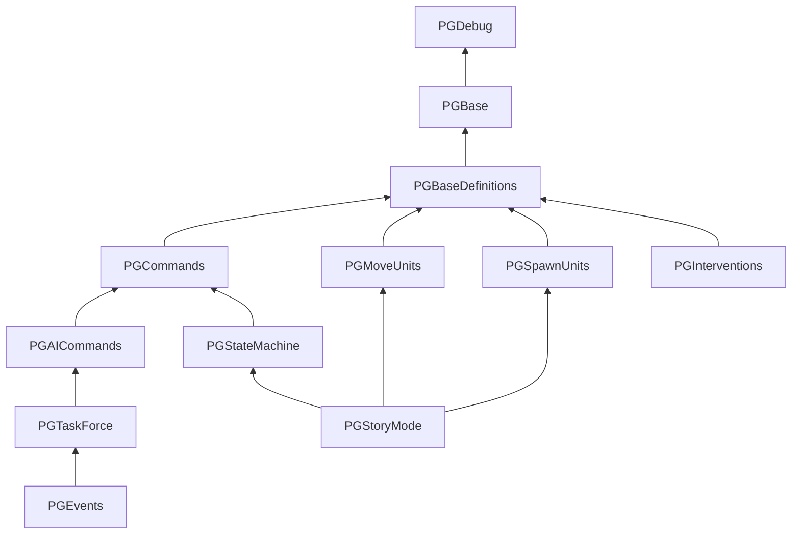

# Libraries

The vanilla `PG*.lua` libraries under `Data/Scripts/Library`. A script requires one of them
and gets that library's whole chain: requiring `PGStateMachine` loads `PGCommands`,
`PGBaseDefinitions`, `PGBase` and `PGDebug` with it. Every function and global a library
defines is on its page, generated from the language server's stubs.

Arrows point at the library a file requires.

| Library | Purpose | Requires |
|---|---|---|
| [`PGDebug.lua`](pgdebug.md) | Debug output: message boxes and log lines, off in the release build. | - |
| [`PGBase.lua`](pgbase.md) | The basics every script uses: ScriptExit, Sleep, PumpEvents, BlockOnCommand, TestValid, Flush_G. | [`PGDebug`](pgdebug.md) |
| [`PGBaseDefinitions.lua`](pgbasedefinitions.md) | The globals Common_Base_Definitions resets, and the base Base_Definitions. | [`PGBase`](pgbase.md) |
| [`PGCommands.lua`](pgcommands.md) | Timers, death, attack and proximity callbacks; abilities, garrisons, weapon switching. | [`PGBaseDefinitions`](pgbasedefinitions.md) |
| [`PGAICommands.lua`](pgaicommands.md) | Base_Definitions for AI plans, and the unit category contrast values. | [`PGCommands`](pgcommands.md) |
| [`PGTaskForce.lua`](pgtaskforce.md) | Task force behaviour for AI plans: assembling, moving, invading, escorting, reinforcing. | [`PGAICommands`](pgaicommands.md) |
| [`PGEvents.lua`](pgevents.md) | The default plan event handlers and their helpers (healing, kiting, good ground). | [`PGTaskForce`](pgtaskforce.md) |
| [`PGStateMachine.lua`](pgstatemachine.md) | The state machine unit and story scripts run on, with its main function. | [`PGCommands`](pgcommands.md) |
| [`PGStoryMode.lua`](pgstorymode.md) | Story scripts: the state per story event and the Story_Event_Trigger entry point. | [`PGStateMachine`](pgstatemachine.md), [`PGSpawnUnits`](pgspawnunits.md), [`PGMoveUnits`](pgmoveunits.md) |
| [`PGMoveUnits.lua`](pgmoveunits.md) | Formation moves for unit lists. | [`PGBaseDefinitions`](pgbasedefinitions.md) |
| [`PGSpawnUnits.lua`](pgspawnunits.md) | Reinforcing and spawning unit lists. | [`PGBaseDefinitions`](pgbasedefinitions.md) |
| [`PGInterventions.lua`](pginterventions.md) | Setup and helpers for intervention plans. | [`PGBaseDefinitions`](pgbasedefinitions.md) |
