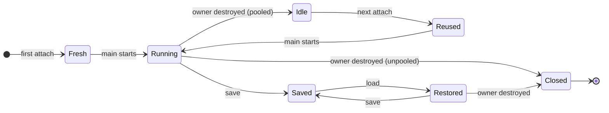
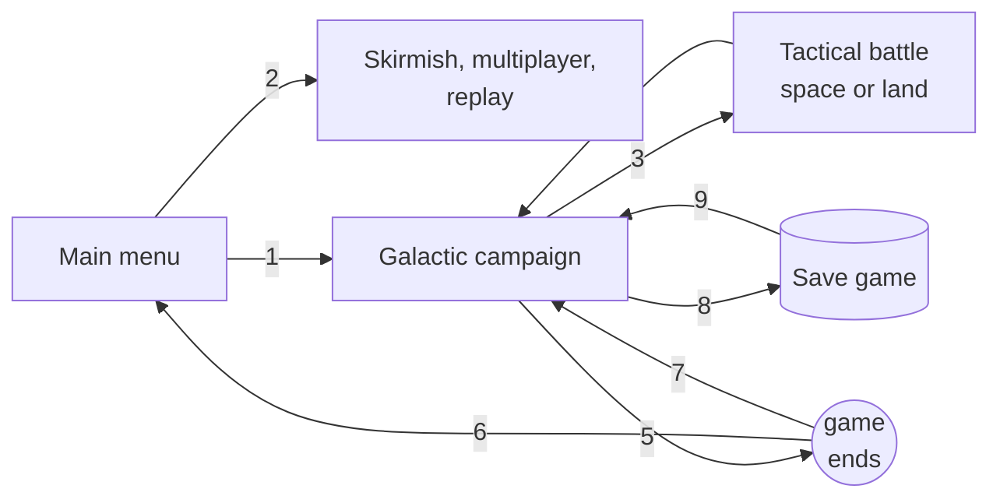

# Lua script lifecycle

This page describes the lifetime of a Lua script state in the game: what happens to a
script's global variables when the object it belongs to is destroyed, when a tactical battle
starts under a galactic campaign, and when the player saves, loads or starts a campaign. The
game reuses script states instead of rebuilding them, so a global variable can outlive the
object it was written for. Two terms are used throughout: a value **carries over** when it
survives into a later owner or a later game, and it is **reset** when the game or the shipped
script library clears it.

The behaviour described is that of Forces of Corruption as shipped on Steam (2024 release) and
of its shipped script library under `Data/Scripts/Library`; the counts and library details come
from the vanilla scripts of both games. Statements marked "inferred" follow from the rules on
this page but were not observed in a running game.

## 1. Lifecycle of one script state

Every script file attached to a unit, a story plot, an AI player or an AI plan runs in its own
Lua state. The state lives longer than the object it was created for.



| Transition | Behaviour |
|---|---|
| first attach, Fresh | the file is executed, `Base_Definitions` is called, `main` is started |
| Running to Idle | the owner is destroyed and the script is pooled: `Flush_G` removes tables and engine object references, `Base_Definitions` is called again, plain values remain |
| Idle to Reused | the next object with the same script file takes the idle state: the file is not executed, `Base_Definitions` is not called, `main` is started |
| Running to Closed | the owner is destroyed and the file set `ScriptPoolCount = 0`: the state is closed and nothing is retained |
| Running to Saved | the whole state is written, code included |
| Saved to Restored | a bare state is created and the saved state merged in: the file is not executed, `Base_Definitions` is not called, `main` is not restarted; the script resumes inside the yield it was saved in |
| Restored to Closed | a restored state is never pooled; the owner's destruction closes it |

Pooling is the default. The first time a script file is needed, the game loads it; if the file
sets `ScriptPoolCount`, the game loads that many states at once, even if not all of them are
needed. The count is not a limit: when every state is in use, the game loads another one. The
game reads `ScriptPoolCount` after the file and everything it requires have run. Only a script
whose file (or a library it requires) sets
`ScriptPoolCount = 0` is closed when its owner is destroyed; the shipped story-mode library
does so, which makes story plot scripts unpooled by default. A state restored from a save game
does not enter the pool either: when its owner is destroyed it is closed, and the next owner
receives a fresh state.

### 1.1 Retained on release to the pool

- Every global whose value is a number, string, boolean or function.
- The values stored in `ThreadValue` and the events queued in `GetEvent`, unless their
  `Reset()` is called.
- The loaded module list: a `require` is not re-executed on reuse.

### 1.2 Removed on release to the pool

- Every global whose value is a table. The library's `Flush_G` retains only `_LOADED`,
  `coroutine`, `string`, `table`, `security`, `LuaWrapperMetaTable` and `_G`.
- Every global that holds an engine object: units, types, players, planets, plots, task
  forces, targets. `Flush_G` deletes every global userdata whose `Is_Pool_Safe()` returns
  false; engine commands and `Script` are kept. The reference is deleted from the state; the
  object may no longer exist.
- All running threads, including `main`. The next owner starts `main` again.

A script that defines no `Flush_G` is not an error: the game skips the call silently and the
state keeps all its globals.

### 1.3 Consequence

!!! warning
    The shipped library's `Common_Base_Definitions` sets the globals it knows about to `nil` and
    calls `ThreadValue.Reset()` and `GetEvent.Reset()`. Script-specific globals are not on that
    list. A number, string or boolean assigned during one owner's lifetime is still assigned when
    the next object with the same script file takes the state, which may be a different unit type
    or a later battle. The library's `Base_Definitions` calls the script's `Definitions()` at that
    moment, so a `Definitions` that assigns its initial values unconditionally restores a defined
    starting state for every owner. A value assigned at the file's top level, outside any function,
    is assigned once, when the state is created, and never again.

## 2. Game-level transitions

Three stores outlive any single script: the states in use, the idle pool, and the
`GlobalValue` store. The save game is a fourth, on disk.



| # | Transition | Scripts in use | Idle pool | GlobalValue |
|---|---|---|---|---|
| - | Game launch | none; the AI plan definition files are executed once and their states released | pre-filled with those plan states | empty |
| 1 | Start a campaign from the menu | new: fresh, or reused from the pool when the file has an idle state | retained | empty (cleared when the previous game ended) |
| 2 | Start a skirmish, multiplayer or replay game | new | freed | unchanged |
| 3 | A battle starts under the campaign | galactic scripts retain their state but are not serviced until the battle ends; a unit in the battle is a new object with its own fresh or reused state, linked to its galactic unit by id only | retained | retained, by design |
| 4 | The battle ends | battle objects destroyed: their states become idle | grows | retained |
| 5 | The game ends: quit, victory, defeat, or a story-driven campaign switch | all owners destroyed: pooled states become idle, the rest are closed | retained | cleared |
| 6 | Return to the menu | none | retained | empty |
| 7 | Story-driven campaign switch (`LOAD_CAMPAIGN` reward) | the ended game is followed by a start as in 1 | retained | empty |
| 8 | Save a game | each script's whole state is written: globals, functions, tables, suspended threads, queued events | idle states of every saved script file are closed | written; a function value stored in it cannot be saved |
| 9 | Load a save game | the previous game ends; every saved script is restored as it was | freed | replaced by the saved store |

The idle pool survives every transition a single-player campaign can perform: a battle, the end
of the game, a new campaign from the menu, a story-driven campaign switch. Only loading a save
game or starting a skirmish, multiplayer or replay game empties it. `GlobalValue` behaves the
other way round: retained through battles by design, cleared whenever the game ends, replaced
on load.

No Lua function is called when a save game is loaded, and no story event signals it. A
restored script continues inside the `Sleep` or `coroutine.yield` it was saved in, on its
owner's next service tick. The script file on disk is opened only to confirm that it exists;
the restored state carries its own copy of the code. An edited file therefore does not affect
an existing save, and a function added to the file after the save does not exist in the
restored state.

## 3. Script categories

### 3.1 Unit and structure scripts (`Lua_Script` on a game object type)

- **Pooled:** yes by default; most shipped unit scripts are.
- **Host-assigned globals:** `Object`, on a fresh or reused attach; on a load it is restored
  from the save.
- **Service:** once per `ServiceRate` seconds of the object's game mode, gated on
  `LastService`; not at all while the galactic game is paused or a battle runs under it. The
  game reads `LastService` and `ServiceRate` from the script and services it only when the
  current game time minus `LastService` exceeds `ServiceRate`; a `nil` `LastService` is
  replaced by the game on the first service. A script whose `ServiceRate` is nil or not a number is never
  serviced: its `main` never runs. The shipped state-machine library sets it to 0.2 before
  `Definitions` runs.

!!! warning
    `LastService` is a plain number and carries over; the library clears it in
    `Common_Base_Definitions`. A script that bypasses that call can inherit a stale value and
    remain unserviced for a long time after reuse (inferred from the service rule; not observed
    in a running game).

### 3.2 Story plot scripts (`Lua_Script` on a story plot)

- **Pooled:** not by default. The pooling rule is the same as for any script; the story-mode
  library sets `ScriptPoolCount = 0` at its top level and every shipped plot requires it, so a
  plot script is closed when its plot is removed. A plot that does not require the library, or
  sets the count itself after the require, is pooled like a unit script. The default is
  appropriate because a plot normally exists once per campaign and gains nothing from reuse.
- **Host calls:** `Story_Event_Trigger(name)` by name, once per matching event.
- **On load:** the plot list is rebuilt; each fresh state is discarded and replaced by the saved
  one.
- **Carries over:** nothing between plots or campaigns.

### 3.3 AI free-store scripts (one per AI player)

- **Pooled:** yes by default.
- **Host-assigned globals:** `FreeStore`, `PlayerObject` and the service timers (`LastService`
  among them), on every attach, load included.
- **Host calls:** `Base_Definitions`, `main`, `On_Unit_Added`.
- **Carries over:** plain-value globals as in any pooled state; `LastService` is unaffected
  because the host assigns it.

### 3.4 AI plan scripts (one per attached plan)

- **Pooled:** yes by default.
- **Host-assigned globals:** `Target`, `AITarget`, `Budget`, `PlayerObject`, one global per
  task force, all assigned after `Base_Definitions`.
- **Carries over:** plain-value globals between plan instances of the same file; `GetEvent`
  holds the task-force events, so a queue that is not reset delivers a previous plan's events.

### 3.5 Evaluator scripts (`Data/Scripts/Evaluators`)

- **Lifetime:** one state per file for the whole session, loaded at launch.
- **Host calls:** `Evaluate` per request, with `PlayerObject` and `Target` assigned;
  `Evaluator_Clean_Up` optional.
- **Carries over:** every global, between evaluations and between games, by design.

### 3.6 Game scoring script (`Game_Scoring_Script_Name` in GameConstants)

- **Lifetime:** one state, re-attached at every player-list reset.
- **Pooled:** yes unless the file opts out, so a reset can return the same state with its
  values intact.

## 4. The GlobalValue store

### 4.1 Semantics

- One store for the whole game session, shared by every script of every category.
- `GlobalValue.Set(name, value)` stores a copy. Numbers, strings and booleans are accepted; a
  table is deep-copied; an engine object (unit, player, planet, the script itself) is rejected
  with an error.
- `GlobalValue.Get(name)` returns a fresh copy, or `nil` when the key is absent. Two scripts
  never share a table through it.
- A function value is accepted at run time but cannot be saved.

### 4.2 Lifetime

- Empty at launch and after every game end.
- Retained through every battle under a campaign; the shipped AI scripts count attacks in it
  for this reason.
- Written into a save game and replaced when one is loaded.
- Cleared by a story-driven campaign switch, because the running game ends before the next one
  starts.

## 5. Script setup

A unit or structure script follows the shipped pattern: `require("PGStateMachine")`, a
`Definitions()` that registers states, sets the service rate and assigns the script's globals,
and a `main` provided by the library. The library's `Base_Definitions` calls
`Common_Base_Definitions()`, rebuilds the state-machine tables and then calls the script's
`Definitions()`. The game calls `Base_Definitions` on the first load of a state and again every
time a state is released to the pool. `Definitions` is therefore the one function that runs for
every owner.

When `Base_Definitions` runs, the host-assigned globals (`Object`, `PlayerObject`, `Target`,
`AITarget`, `Budget`, `FreeStore`) are not yet set; the game assigns them afterwards, so
`Definitions()` cannot use them. A script without `Base_Definitions` is not an error; the game
skips the call silently.

### 5.1 Required practice

- Assign every initial value in `Definitions()`, unconditionally. It runs for the first owner
  and again at every release, so each owner starts from the same values.
- Keep per-owner data in tables created in `Definitions()`; tables are rebuilt for every
  owner.
- Give the state machine a setup state that handles `OnEnter` only, acquires what the script
  needs and transitions to the first operational state. It runs for every fresh or reused
  owner because `main` is restarted for each.
- Begin the setup state with a game-mode check and `ScriptExit()` when the mode is not the
  intended one. The same script file is attached to the unit in galactic, space and land mode
  alike; the shipped hero scripts exit this way before any mode-specific call.
- Acquire engine objects (units, players, planets, plots) in a state's `OnEnter` and validate
  them with `TestValid()` before use.
- Keep the data a resumed script needs in globals, and write each state so that resuming in
  the middle of a `Sleep` has no side effects.
- Use `GlobalValue` for values that cross scripts or battles; prefix keys with the mod's name;
  store plain values or small tables.
- Verify behaviour in a second battle as well as the first, and after a save and load taken in
  the middle of a state.
- Monitor the script log during tests: a thread that raises a Lua error is removed, and the rest
  of the script continues. An argument error in an engine function (wrong parameter count or
  type, a function used in the wrong game mode, `Prevent_AI_Usage` on an owner whose AI is not
  active) is logged and ends the whole script at the end of that service tick, like
  `ScriptExit()`; a pooled script returns to the pool and the unit runs on without a script.

### 5.2 Practices to avoid

- Do not use `nil` as a first-run marker for a number, string, boolean or function global;
  assign it in `Definitions()`.
- Do not assign a script global at the file's top level; that statement runs once, when the
  state is created, and never for a later owner.
- Do not retain engine objects in globals beyond the state that acquired them; they are removed
  at release and invalid once the object is gone.
- Do not define `Base_Definitions` in a script that requires the library; it replaces the
  library's, which is what calls `Common_Base_Definitions()` (the `LastService`, `ThreadValue`
  and `GetEvent` resets) and the script's `Definitions()`. If it is unavoidable, call both.
- Do not set `ScriptPoolCount = 0` on a common unit script as a workaround for reset problems;
  it costs a file parse per attach. Correct `Definitions()` instead.
- Do not use upvalues in any script that can be in a save game. A function that captures a
  local declared outside it is saved as its code plus the number of captured variables and is
  restored with undefined bindings, so its next use of such a variable after a load crashes
  the game or corrupts memory. Functions that use only globals, their parameters and their
  own locals are safe. Independently of that, an edit to a script file does not reach an
  existing save, which carries its own copy of the code, so a loaded game can run the saved
  version of a script next to the new version in states created later.
- Do not wait for a load event or restart `main` logic manually; no such event exists, and a
  restored script continues where it was.
- Do not expect a galactic unit's script to run during a battle or a galactic pause, and do not
  measure time by wall clock.
- Do not store functions or engine objects in `GlobalValue`.
- Do not place machine-local values in globals; in multiplayer every pooled state is part of
  the synchronisation check.

### 5.3 Reference skeleton

???+ example "Reference skeleton"

    ```lua
    require("PGStateMachine")

    -- No assignments at file level: the file is executed once per state, not once per owner.

    function Definitions()
        DebugMessage("%s -- In Definitions", tostring(Script))
        ServiceRate = 1.0           -- the library assigned 0.2 immediately before this call
        Define_State("State_Init", State_Init)
        Define_State("State_Patrol", State_Patrol)

        kills_this_life = 0         -- every global the script reads, assigned here on every call
        patrol_index = 1
        escorts = {}                -- per-owner table, rebuilt for each owner
        my_player = nil             -- engine objects: declared here, acquired once in State_Init
        station = nil
    end

    -- State_Init is the setup state: OnEnter only, then a transition. It runs for every
    -- owner because main is restarted per owner. It does not run after a load, and need not:
    -- the objects it acquired are restored from the save.
    function State_Init(message)
        if message == OnEnter then
            if Get_Game_Mode() ~= "Space" then   -- "Galactic", "Space" or "Land"
                ScriptExit()                     -- not the intended mode: terminate the script
            end

            -- Acquired once per owner. Both are nil again when the next owner receives this
            -- state: Flush_G removed the objects, Definitions assigned nil to the names.
            my_player = Object.Get_Owner()
            station = Find_First_Object("Empire_Star_Base_2")

            Set_Next_State("State_Patrol")
        end
    end

    function State_Patrol(message)
        if message == OnUpdate then
            -- A reference acquired once is not valid indefinitely: the station can be destroyed.
            if not TestValid(station) then
                station = Find_First_Object("Empire_Star_Base_2")
                if not TestValid(station) then
                    return                       -- no station exists; nothing to do this tick
                end
            end
            -- operate on station and my_player
        end
    end
    ```
